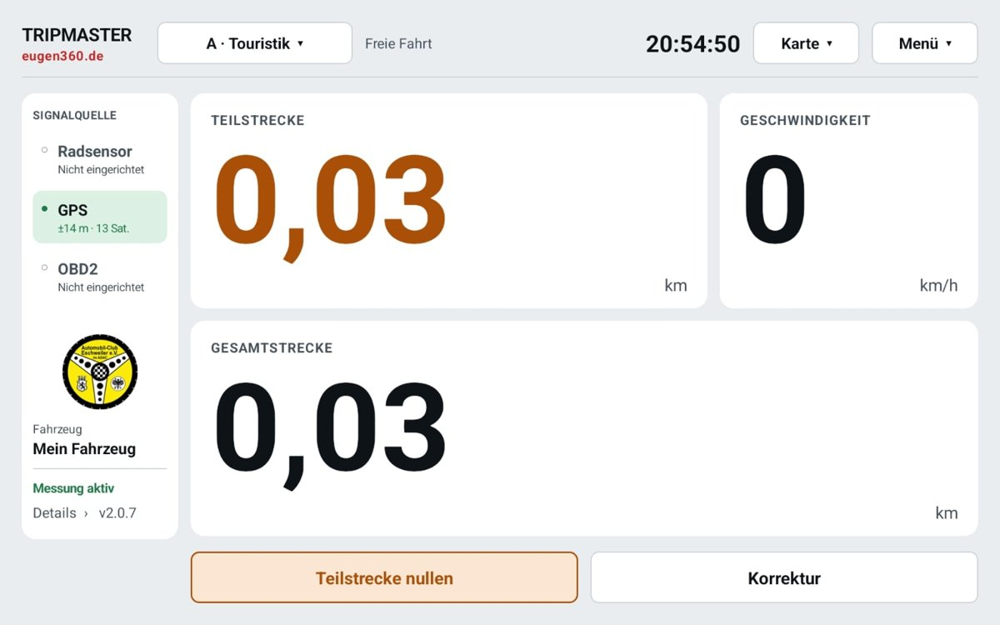

# Tripmaster by eugen360.de

GPS-Tripmaster für Rallyes, Touristik- und Oldtimer-Ausfahrten – große, gut ablesbare Ziffern auf Android-Handy oder -Tablet.

## Herunterladen

| | |
|---|---|
| 📱 **App (Android)** | **[Tripmaster.apk herunterladen](https://github.com/eugen-hue/tripmaster-download/releases/latest/download/Tripmaster.apk)** |
| 📖 **Bedienungsanleitung** | **[Tripmaster-Anleitung.pdf](https://github.com/eugen-hue/tripmaster-download/releases/latest/download/Tripmaster-Anleitung.pdf)** |
| 📝 **Was ist neu?** | [Alle Versionen](https://github.com/eugen-hue/tripmaster-download/releases) |
| 🔒 **Datenschutz** | [Datenschutzerklärung](https://eugen360.de/tripmaster-datenschutz.html) |

Die Links zeigen immer auf die **neueste Version**.

*QR-Code mit der Handykamera scannen, um diese Seite auf dem Handy zu öffnen.*

## Installieren

1. Auf dem Handy oder Tablet **Tripmaster.apk herunterladen** und antippen.
2. Beim ersten Mal fragt Android, ob der Browser Apps installieren darf: **Zulassen** („Installation aus unbekannten Quellen“).
3. **Installieren** → **Öffnen**.
4. Standort **„Genau“** und **Benachrichtigungen** erlauben.

**Updates:** Einfach den Link erneut öffnen und die neue Datei drüberinstallieren – deine Einstellungen bleiben erhalten.
In der App findest du die Anleitung jederzeit unter **Menü → Bedienungsanleitung (PDF)**.

Bitte vor jeder Veranstaltung in der Ausschreibung prüfen, ob GPS-Tripmaster und Tablets in deiner Klasse erlaubt sind.

## Danke an unsere Unterstützer

- **AC Eschweiler** – Automobil-Club Eschweiler e.V. im ADAC
- **OC Stolberg** – Oldtimerclub Stolberg e.V. im ADAC

---

Entwickelt von [eugen360.de](https://eugen360.de) · Fragen, OBD2-Dongle oder Radsensor für Oldtimer auf Anfrage.

[Datenschutzerklärung](https://eugen360.de/tripmaster-datenschutz.html) · [Impressum](https://eugen360.de/index.php?page=impressum)
